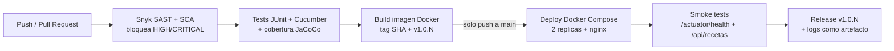

# Recetas — Microservicio de riesgo recetas

Microservicio correspondiente al **caso caso07 — MediCare** (Telemedicina) de la Evaluación Parcial N°1.

| | |
|---|---|
| Asignatura | JVY0101 — Java: Diseño y Construcción de Soluciones Nativas en Nube |
| Stack | Spring Boot 3.3 · Java 21 · Maven · Spring Data JPA · H2 · springdoc-openapi |
| Calidad | JaCoCo cobertura LINE 100% · Cucumber (BDD) alineado a endpoints REST |
| Entrega | Docker / Docker Compose |

## Entrega EP2 — Mapa de evaluación

| Indicador | Qué se implementó | Dónde verlo |
|-----------|-------------------|-------------|
| **IE1** — Contenedores | Dockerfile multi-stage (Maven → JRE), usuario no-root, healthcheck real | [`Dockerfile`](Dockerfile) · [Evidencias Fase 1](docs/evidencias/EVIDENCIAS.md#fase-1--contenedorización-ie1) |
| **IE2** — Pruebas en CI | JUnit + MockMvc + Cucumber, cobertura JaCoCo ≥ 70% | [`pipeline.yml`](.github/workflows/pipeline.yml) · [Evidencias Fase 2](docs/evidencias/EVIDENCIAS.md#fase-2--pruebas-automatizadas-en-ci-ie2) |
| **IE3** — Seguridad y bloqueo | Dependabot + Snyk SAST/SCA con bloqueo HIGH/CRITICAL, recursos y réplicas | [`SECURITY.md`](SECURITY.md) · [`dependabot.yml`](.github/dependabot.yml) · [Evidencias Fase 3](docs/evidencias/EVIDENCIAS.md#fase-3--seguridad-y-bloqueo-en-el-pipeline-ie3) |
| **IE4** — Deploy y trazabilidad | Deploy automático tras seguridad y tests, imagen por SHA, Release `v1.0.N`, logs | [Pipeline CI/CD](#pipeline-cicd-ep2) · [Trazabilidad](#trazabilidad) · [Evidencias Fase 4](docs/evidencias/EVIDENCIAS.md#fase-4--despliegue-automático-y-trazabilidad-ie4) |
| **IE5** — Orquestación | Docker Compose: 2 réplicas + nginx balanceador, límites de recursos, healthchecks | [`docker-compose.yml`](docker-compose.yml) · [`nginx.conf`](nginx/nginx.conf) |
| Reflexiones y uso de IA | Declaración de IA y reflexión individual de cada integrante (sin IA) | [Uso de IA](#uso-de-inteligencia-artificial-ep2) · [Reflexiones](#reflexiones-individuales-ep2) |

## Pipeline CI/CD (EP2)



| Etapa | Job | Qué hace | Si falla |
|-------|-----|----------|----------|
| 1. Seguridad | `security-analysis` | Snyk Code (SAST) y Snyk Open Source (SCA) con `--severity-threshold=high` | Detiene todo el pipeline |
| 2. Calidad | `test-and-coverage` | `mvn clean verify`: pruebas unitarias, de controlador y BDD (Cucumber) + umbral JaCoCo | No se construye la imagen |
| 3. Build | `docker-build` | Imagen multi-stage etiquetada con el SHA del commit y `v1.0.N`, con labels OCI; se guarda como artefacto | No se despliega |
| 4. Deploy | `deploy` | Solo en `push` a `main`: carga **la misma imagen probada**, levanta Compose, ejecuta smoke tests y publica release | El release no se crea y quedan los logs |

## Despliegue automático (IE4)

- **Entorno:** cloud simulado en el runner de GitHub Actions (`ubuntu-latest`), registrado como entorno `produccion-simulada` (pestaña *Environments / Deployments*).
- **Condición:** el job `deploy` depende (`needs`) de seguridad, pruebas y build; además solo corre tras el merge a `main`. En los PR aparece como *skipped*.
- **Topología:** 2 réplicas de `recetas-svc` (límite 0.5 CPU / 512 MB c/u) detrás de un **nginx** que balancea la carga (round-robin). Compose espera a que todos los servicios estén *healthy* (`--wait`).
- **Verificación post-deploy:** `/actuator/health` debe responder `UP`, `/api/recetas` debe responder 200, y se comprueba que ambas réplicas atienden peticiones (header `X-Upstream`).
- **Ejecución local equivalente:** `docker compose up -d --build --wait` → http://localhost:8080

## Trazabilidad

Cada despliegue se puede rastrear hasta el commit exacto que lo originó:

| Elemento | Cómo se vincula al commit |
|----------|---------------------------|
| Imagen Docker | Tag `recetas-app:<GITHUB_SHA>` y `recetas-app:v1.0.<run_number>` |
| Metadatos de la imagen | Labels OCI `org.opencontainers.image.revision` (SHA) y `.version` |
| Release / Tag Git | `v1.0.N` creado automáticamente apuntando al SHA desplegado |
| Logs del despliegue | Artefacto `deploy-logs-v1.0.N` (`deploy-info.json`, `compose-ps.txt`, `compose-logs.txt`, `image-labels.json`) |
| Resumen del run | Tabla con versión, commit, imagen y autor en el *Summary* del run |
| Código | Ramas `feature/*` + Pull Request + Conventional Commits |

## Cómo se garantiza la calidad

1. **Seguridad primero:** ningún cambio con vulnerabilidades HIGH/CRITICAL no gestionadas avanza (ver [`SECURITY.md`](SECURITY.md)).
2. **Pruebas obligatorias:** unitarias (servicio), de integración (controlador con MockMvc) y BDD (Cucumber); el build falla si alguna falla o si la cobertura baja del umbral.
3. **Build once, deploy many:** se despliega exactamente la imagen que pasó las pruebas, no una reconstruida.
4. **Verificación post-deploy:** si los smoke tests fallan, el job falla y no se publica release.
5. **Revisión por PR:** todo cambio entra a `main` mediante Pull Request con el pipeline en verde.
6. **Dependencias al día:** Dependabot revisa semanalmente Maven y GitHub Actions y abre PRs automáticos; cada PR pasa por el mismo pipeline antes de poder integrarse.

## Orquestación de contenedores (IE5)

Se eligió **Docker Compose** como orquestador: es suficiente para el tamaño del servicio y se ejecuta igual en local y en el pipeline. Configuración en [`docker-compose.yml`](docker-compose.yml).

| Parámetro | Valor | Propósito |
|-----------|-------|-----------|
| Réplicas | 2 | Alta disponibilidad: si una cae, la otra sigue atendiendo |
| Límite CPU / RAM | 0.50 core / 512 MB por réplica | Evita que una réplica consuma todos los recursos del host |
| Reserva CPU / RAM | 0.25 core / 256 MB por réplica | Garantiza recursos mínimos para arrancar |
| Balanceador | nginx (round-robin) | Distribuye las peticiones entre réplicas |
| Healthcheck | `/actuator/health` cada 15 s | Docker detecta si cada réplica responde de verdad (no solo si está encendida); su estado se ve en `docker compose ps` |
| Usuario | `appuser` (no-root) | Reduce el impacto ante una vulnerabilidad |
| Autorrecuperación | `restart: unless-stopped` | Si una réplica se cae, Docker la reinicia automáticamente |
| Arranque ordenado | `depends_on: condition: service_healthy` | nginx solo arranca cuando las réplicas están sanas |

## Uso de Inteligencia Artificial (EP2)

En este encargo se utilizaron herramientas de IA generativa (Claude/Gemini) como **apoyo**, no como reemplazo del trabajo del equipo.

- Estructuración de Pipeline CI/CD: Asistencia en la sintaxis de archivos YAML para GitHub Actions (definición de jobs, steps, environment variables y triggers).

- Diagnóstico y Corrección de Errores (Troubleshooting): Depuración de fallos de compilación en Maven, resolución de errores de autenticación/módulos en Snyk (SCA/SAST), y mitigación de vulnerabilidades mediante parches de dependencias en pom.xml.

- Configuración de Docker y Docker Compose: Asistencia en la sintaxis de límites de recursos (limits, reservations), estrategias de escalabilidad y directivas de seguridad (usuario appuser, HEALTHCHECK).

**Validación de Código**: Todo el código, script y archivo de configuración generado o sugerido por la IA fue revisado, probado, ejecutado y validado manualmente por la estudiante en un entorno local (Git Bash / Docker) y en la plataforma GitHub Actions.

## Reflexiones individuales (EP2)

### Reflexión individual — Stefany Duhalde
A decir verdad, este trabajo me costó mucho... Tuve muchos errores que me dejaron parada varias veces. Uno de ellos fue cuando la verificación de seguridad de Snyk fallaba en varios Pull Requests. Me costó entender por qué el job de Dependabot no veía el token, y era porque había creado el secret de Dependabot vacío. Una vez editado eso, logré avanzar a las otras verificaciones de seguridad con normalidad. Por un lado puede ser fastidioso no poder avanzar con el merge, pero por el otro lado se evidencia la importancia de tener estas distintas etapas de seguridad, para evitar que al hacer merge a la rama main, se integren códigos de mala calidad o dependencias con vulnerabilidades. También aprendí lo que es la trazabilidad, que básicamente es dejar pistas conectadas por cada deploy, y así saber quién hizo un cambio, quién revisó, qué checks pasaron, etc. Para una próxima entrega intentaría ser más cautelosa con la creación de secrets, ya que realmente fue un paso que generó retrasos en el proyecto.

# README Entrega Evaluación 1 

## Responsabilidad (SRP)

administra los datos y la lógica del dominio de Recetas del caso caso07 (MediCare). Su base de datos es una **H2 en memoria** (un solo microservicio por base), cumpliendo aislamiento de datos por dominio.

## Página de presentación

Al ejecutar el servicio, `http://localhost:8080/` muestra la página de presentación del microservicio con documentación y enlaces a:

- **Swagger UI**: `/swagger-ui/index.html`
- **OpenAPI (yaml)**: `/v3/api-docs.yaml`
- **ReDoc**: `/redoc.html`
- **H2 Console**: `/h2-console`

## Endpoints

| Método | Ruta | Descripción |
|--------|------|-------------|
| GET | `/api/recetas` | Lista todos los recursos |
| GET | `/api/recetas/{id}` | Obtiene un recurso por id |
| POST | `/api/recetas` | Crea un recurso |
| PUT | `/api/recetas/{id}` | Actualiza un recurso |
| DELETE | `/api/recetas/{id}` | Elimina un recurso |

## Documentación del proyecto

La documentación completa está en la carpeta [`docs/`](docs/):

- [`docs/00_Resumen.md`](docs/00_Resumen.md) — propósito, responsabilidad y tecnologías
- [`docs/01_Arquitectura.md`](docs/01_Arquitectura.md) — componentes, arquitectura y patrones
- [`docs/02_API.md`](docs/02_API.md) — contrato REST y ejemplos curl
- [`docs/03_Pruebas.md`](docs/03_Pruebas.md) — tests unitarios, cobertura y Cucumber
- [`docs/04_Despliegue.md`](docs/04_Despliegue.md)
- [`docs/05_Justificacion.md`](docs/05_Justificacion.md) — justificación del servicio: RF/RNF/seguridad cubiertos, stack y por qué cada tecnología AWS
- [`docs/diagramas/`](docs/diagramas/) — C4 (contexto, contenedores, componentes), secuencia e infraestructura AWS — Docker, Docker Compose e integración

## Cómo ejecutar locmente

```bash
mvn spring-boot:run
```

## Cómo ejecutar con Docker

```bash
docker compose up --build
# http://localhost:8080
```

## Cómo ejecutar las pruebas

```bash
mvn test      # unit tests + Cucumber
mvn verify    # + verificación de cobertura JaCoCo (100% LINE, falla si baja)
```
##  Método de ramificación

Elegimos GitFlow ya que esta es ideal para proyectos con releases planficados, los cuales corresponderán a nuestras entregas de pruebas parciales a lo largo del semestre. Además, la estructura clásica de Gitflow está compuesta por las ramas "main", "develop", "hotfix/" y "feature/", que es lo que se exige en la pauta de la entrega 1. De esta manera, en la rama "develop" podemos seguir avanzando con el código nuevo de cada entrega, en las ramas "hotfix/" se podrán realizar arreglos rápidos sin mezclar los cambios con los códigos sin terminar de "develop", y en la rama "main" mantendremos la versión final y estable de cada entrega.

### Convención de Commits
Formato: `tipo(alcance): descripcion-corta` (Escrito en minúsculas y sin tildes).

| Tipo | Para qué | Ejemplo |
| :--- | :--- | :--- |
| **feat** | Nueva funcionalidad | `feat(ui): agregar pie de pagina` |
| **fix** | Corrección de bug | `fix(home): corregir titulo` |
| **docs** | Documentación | `docs: agregar changelog` |
| **chore** | Tareas / CI | `chore(ci): agregar workflow hola mundo` |

### Naming de Ramas
- Estructura: `feature/<feature-name>` y `hotfix/<feature-name>`, en minúsculas y separadas con guiones.
- Ejemplos: `feature/pagina-presentacion`, `hotfix/titulo-pagina`.

### Flujo de Merge
- Las *features* y *hotfixes* siempre entran mediante **Pull Request**, nunca con *push* directo a `main` o `develop`.
- Se requiere al menos **1 aprobación** del compañero antes de fusionar.
- Usar *merge commit* o *squash*, y borrar la rama inmediatamente después de fusionar (*delete branch*).

### Estrategia de Revisión
- El autor crea el Pull Request y asigna a un integrante del equipo como revisor.
- El revisor comenta, aprueba o solicita cambios; nunca se fusiona un PR sin haber sido revisado previa y detalladamente.
- Antes de abrir cada PR: confirmar que los tests de `mvn test` pasan de forma exitosa y revisar detenidamente el *diff* del código.

### Reflexion individual Tais
- A lo largo de este proyecto aprendí a estructurar un flujo de trabajo profesional utilizando GitFlow. Lo más valioso fue entender el impacto de los entornos de integración continua mediante GitHub Actions, ya que nos permitió automatizar las verificaciones de nuestro microservicio en Spring Boot y asegurar que el código en develop y main fuera siempre estable. Mi aporte principal estuvo centrado en la gestión de ramas, la creación de la documentación base (CHANGELOG.md y README.md) y la participación activa como autor y revisor de Pull Requests, lo que me ayudó a comprender la importancia de la colaboración y las revisiones de código antes de cada merge.

### Reflexión individual Stefany D.
- En este trabajo adquirí conocimientos sobre Git y GitHub; aprendí a manejar la herramienta a través de comandos en la terminal y, sobre todo, a ver reflejados estos cambios locales en el repositorio remoto y viceversa. Considero que la curva de aprendizaje fue bastante empinada en un principio, pero poco a poco el proceso se volvió más fluido a medida que comprendía mejor el uso de los comandos y la lógica de Git. También aprendí la diferencia entre los distintos modelos de ramificación y la importancia de elegir el adecuado según el contexto del proyecto. En nuestro caso, TBD no habría sido la mejor opción ya que, si bien las integraciones son más dinámicas, requiere de un equipo con mayor experiencia en automatización de pruebas y pipelines de CI/CD, que no es nuestro caso. En cuanto a mi rol y aporte en el trabajo, me encargué de la creación y gestión de ramas (feature y hotfix), su posterior integración (merge) con la rama main, y la implementación y verificación del workflow en GitHub Actions. También me encargué de crea, revisar y aprobar Pull requests.

### Uso de Inteligencia Artificial

Utilizamos Gemini como herramienta de apoyo puntual a lo largo del laboratorio:

Comandos y flujo de Git: Nos ayudó a resolver dudas con los comandos en la terminal, cómo sincronizar develop con main tras el hotfix y cómo manejar los reverts cuando nos equivocamos en un merge.


GitHub Actions: Fue una guía para revisar la sintaxis de los archivos YAML en la carpeta .github/workflows y asegurarnos de que la integración continua corriera sin errores.


