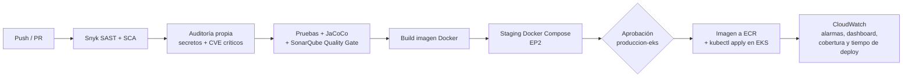

<!--
  PLANTILLA para pegar en README.md (EP3), despues de la seccion de la EP2.
  Las partes con ✍️ las escriben ustedes, SIN IA (la rubrica prohibe IA en
  justificaciones tecnicas, conclusiones y reflexiones). Borren este comentario.
-->

# EP3 — Observabilidad y entornos reales

## Mapa de evaluación EP3

| Indicador | Qué se implementó | Dónde verlo |
|-----------|-------------------|-------------|
| **IE1** — Monitoreo | Amazon CloudWatch: CPU/memoria (Container Insights), errores 5xx y disponibilidad (Load Balancer), logs del microservicio (CloudWatch Logs), alarmas con correo (SNS) | [`monitoring/`](monitoring) · [Cómo verificar el monitoreo](#cómo-verificar-el-monitoreo) |
| **IE2** — Kubernetes en la nube | Amazon EKS 1.32 (AWS Academy). El pipeline publica la imagen en ECR, despliega con `kubectl apply` y configura CloudWatch | [`k8s/`](k8s) · job `deploy-eks` |
| **IE3** — Dashboard | Dashboard `Recetas-DevOps` como código: CPU/memoria, errores 5xx, cobertura y tiempo de despliegue | [`dashboard-recetas.json`](monitoring/dashboard-recetas.json) |
| **IE4** — Decisiones | Mapa del pipeline, por qué cada herramienta, panel → decisión → acción | [Decisiones técnicas](#decisiones-técnicas-con-los-datos) |
| **IE5** — Cumplimiento | SonarQube (quality gate) + branch protection + auditoría propia | [Políticas](#políticas-de-cumplimiento) · [`audit/`](audit) |
| **IE6** — Freno | Puertas secuenciales + producción con revisores + falla inyectada | [Freno del pipeline](#freno-del-pipeline) · [Evidencias](docs/evidencias/EVIDENCIAS-EP3.md) |

## Mapa del pipeline (EP2 + EP3)



Bloques nuevos de la EP3: auditoría propia, SonarQube, aprobación, despliegue en EKS y CloudWatch.

## Infraestructura

- Clúster **EKS `recetas-eks`, Kubernetes 1.32**, creado desde la consola con el rol `LabRole`.
- Nodos **Amazon Linux 2** (`AL2_x86_64`), creados con AWS CLI:

```bash
aws eks create-nodegroup --cluster-name recetas-eks --nodegroup-name ng-recetas \
  --node-role arn:aws:iam::<CUENTA>:role/LabRole --subnets <SUBNETS> \
  --ami-type AL2_x86_64 --capacity-type SPOT --instance-types t3.large \
  --disk-size 20 --scaling-config minSize=1,maxSize=3,desiredSize=1
```

- Complemento **Amazon CloudWatch Observability** (Container Insights + logs).

✍️ *Expliquen con sus palabras por qué se usó Kubernetes 1.32 con nodos Amazon Linux 2 (restricción de AWS Academy que encontraron).*

## Cómo verificar el monitoreo

1. Abrir el último run de `main` → job **Deploy a Kubernetes en AWS EKS (EP3)** → *Summary*: URL del microservicio.
2. Consola AWS → **CloudWatch → Paneles → Recetas-DevOps**.
3. **CloudWatch → Container Insights** → clúster `recetas-eks`.
4. **CloudWatch → Alarmas**: las alarmas `recetas-*`.

| Señal | Origen | Dónde se ve |
|-------|--------|-------------|
| Uso (CPU / memoria) | Container Insights (complemento de CloudWatch) | Dashboard · Container Insights |
| Errores 5xx | Métrica `HTTPCode_Backend_5XX` del Load Balancer | Dashboard · alarma `recetas-errores-5xx` |
| Disponibilidad | `HealthyHostCount` del Load Balancer + pods en ejecución | Dashboard · alarma `recetas-disponibilidad` |
| Logs | CloudWatch Logs `/aws/containerinsights/recetas-eks/application` + métrica de líneas `ERROR` | Dashboard (tabla de logs) · alarma `recetas-errores-log` |
| Cobertura y tiempo de despliegue | Publicadas por el pipeline (`put-metric-data`) | Dashboard |

## Decisiones técnicas con los datos

### Por qué cada herramienta
✍️ *Una o dos oraciones por herramienta, con sus palabras: EKS, ECR, CloudWatch (Container Insights, Logs, alarmas, SNS), SonarQube, auditoría propia, branch protection.*

### Panel → decisión → acción
✍️ *Con ejemplos reales observados en su dashboard (valores concretos).*

| Panel | Qué observamos | Decisión | Acción |
|-------|----------------|----------|--------|
| Uso de CPU de los pods | ✍️ | ✍️ | ✍️ |
| Uso de memoria de los pods | ✍️ | ✍️ | ✍️ |
| Errores 5xx | ✍️ | ✍️ | ✍️ |
| Cobertura de pruebas | ✍️ | ✍️ | ✍️ |
| Tiempo de despliegue | ✍️ | ✍️ | ✍️ |
| Disponibilidad | ✍️ | ✍️ | ✍️ |

## Políticas de cumplimiento

| Política | Herramienta | Verificación |
|----------|-------------|--------------|
| Código con calidad y seguridad mínima | **SonarQube Cloud** (Quality Gate) | Paso *SonarQube Cloud* del job de pruebas: si el gate no pasa, el job falla (`sonar.qualitygate.wait=true`) |
| Nadie integra a `main` sin PR ni controles | **Branch protection** (ruleset de `main`) | PR obligatorio + status checks en verde; GitHub bloquea el merge si no |
| Sin secretos en el repositorio | **Auditoría propia** [`audit/audit.sh`](audit/audit.sh) | Job *Auditoria de Cumplimiento*: falla y deja `audit-report.md` |
| Sin CVE críticos en dependencias | **Auditoría propia** (Snyk `--severity-threshold=critical`) | Ídem |
| Sin vulnerabilidades HIGH/CRITICAL (EP2) | **Snyk** SAST + SCA | Job *DevSecOps* |
| Producción solo con aprobación | **Environment `produccion-eks`** con revisores | El deploy a EKS espera la aprobación de un revisor |
| Logs disponibles para auditoría | **CloudWatch Logs** (retención 7 días) | `monitoring/configurar-cloudwatch.sh` |

## Freno del pipeline

Las puertas son **secuenciales** (`needs`): si una falla, todas las siguientes —incluido el deploy— quedan *skipped*.

`Snyk → Auditoría → Pruebas + SonarQube → Build → Staging → (aprobación) → Deploy EKS`

Evidencia de la falla inyectada (rama `demo/secreto-falso`): [EVIDENCIAS-EP3.md](docs/evidencias/EVIDENCIAS-EP3.md#ie6--freno-del-pipeline).

## Uso de Inteligencia Artificial (EP3)
✍️ *Herramienta, para qué se usó y cómo se validó. Citar según https://bibliotecas.duoc.cl/ia*

## Reflexiones individuales (EP3)
✍️ *Una por integrante, sin IA: aprendizaje y contribución.*
