# Evidencias EP2 — Ingeniería DevOps (DOY0101)

Microservicio **Recetas** (Spring Boot / Java 21) — Pipeline CI/CD con GitHub Actions.

| Fase | Indicador | Evidencia |
|------|-----------|-----------|
| 1 | IE1 — Contenedores e imágenes optimizadas | [Ir a Fase 1](#fase-1--contenedorización-ie1) |
| 2 | IE2 — Pruebas automatizadas en CI | [Ir a Fase 2](#fase-2--pruebas-automatizadas-en-ci-ie2) |
| 3 | IE3 — Seguridad y bloqueo en el pipeline | [Ir a Fase 3](#fase-3--seguridad-y-bloqueo-en-el-pipeline-ie3) |
| 4 | IE4 — Despliegue automático y trazabilidad | [Ir a Fase 4](#fase-4--despliegue-automático-y-trazabilidad-ie4) |

---

## Fase 1 — Contenedorización (IE1)

**Objetivo:** construir una imagen Docker optimizada mediante *multi-stage build* (Maven → JRE), ejecutada con usuario no privilegiado y con `HEALTHCHECK` configurado.

### 1.1 Construcción exitosa de la imagen (Git Bash)
Comando ejecutado: `docker build -t recetas-app:v1 .`

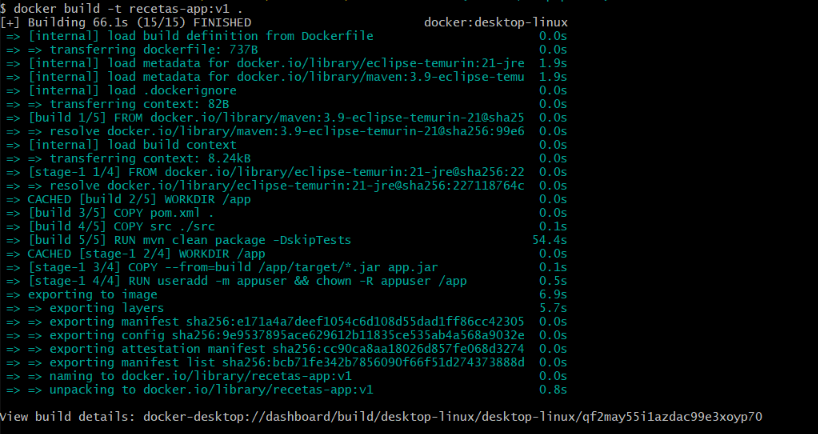

### 1.2 Imagen disponible en Docker Desktop

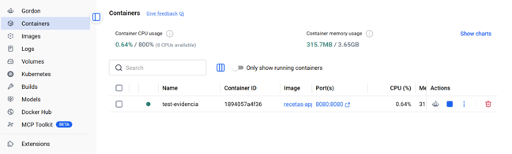

### 1.3 Contenedor en ejecución — microservicio respondiendo en el puerto 8080
Comando ejecutado: `docker run -d -p 8080:8080 recetas-app:v1`

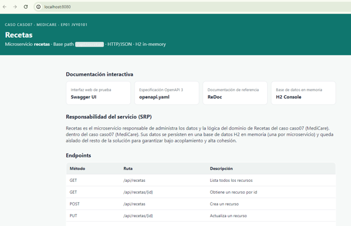

### 1.4 Imagen ligera y estado del healthcheck
Comandos ejecutados: `docker images recetas-app` y `docker ps`

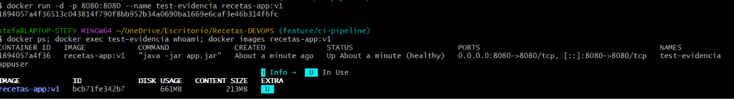

### 1.5 Contenedor ejecutándose con usuario no-root
Comando ejecutado: `docker exec <contenedor> whoami`

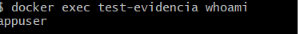

---

## Fase 2 — Pruebas automatizadas en CI (IE2)

**Objetivo:** ejecutar automáticamente las pruebas (JUnit + Cucumber) con verificación de cobertura JaCoCo en cada push/PR, y validar el build de la imagen Docker solo si las pruebas pasan.

### 2.1 Pipeline en verde en GitHub Actions
Jobs: `Pruebas Automatizadas y Cobertura (IE2)` → `Validacion Docker Build`

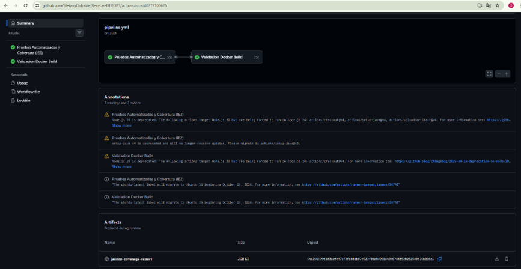

**Resultado:** ambos jobs finalizan correctamente; el reporte de cobertura JaCoCo queda publicado como artefacto (`jacoco-coverage-report`) en cada ejecución.

---

## Fase 3 — Seguridad y bloqueo en el pipeline (IE3)

**Objetivo:** integrar análisis de seguridad automático (Dependabot + Snyk SAST/SCA) que **detenga el pipeline** ante vulnerabilidades de severidad HIGH o CRITICAL. Política completa en [`SECURITY.md`](../../SECURITY.md).

### 3.1 Bloqueo inicial (Spring Boot 3.3.5)
Snyk detectó vulnerabilidades HIGH/CRITICAL en Tomcat embebido, retornó `exit code 1` y los jobs `test-and-coverage` y `docker-build` **no se ejecutaron**.

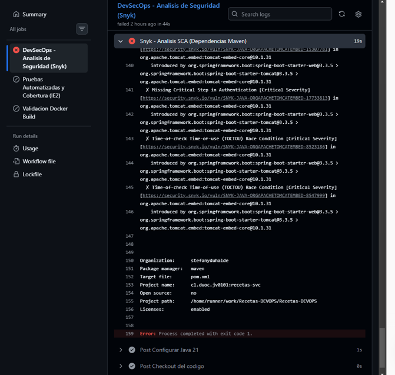

### 3.2 Segundo bloqueo y remediación
Con Spring Boot 3.5.7 (línea 3.x sin soporte OSS) Snyk reportó 51 vulnerabilidades. Se migró a **Spring Boot 4.0.9** y **springdoc 3.0.3**, quedando 1 vulnerabilidad sin parche disponible (XXE en `jaxb-core`).

### 3.3 Excepción controlada y pipeline en verde
La vulnerabilidad sin parche se gestionó con una excepción en `.snyk` con justificación técnica y vencimiento (2027-01-26), registrada en `SECURITY.md`. El pipeline completo pasa en verde.

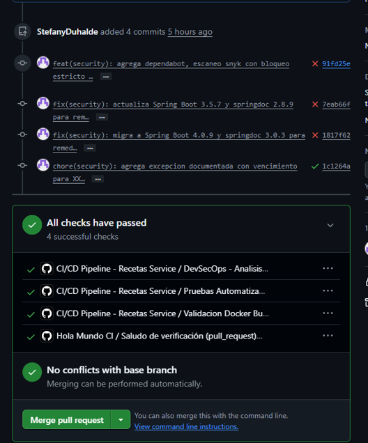

**Resultado:** el pipeline actúa como puerta de seguridad. Ningún cambio con vulnerabilidades HIGH/CRITICAL no gestionadas avanza a pruebas, build ni merge a `main`.

### 3.4 Dependabot activo
Dependabot abre automáticamente Pull Requests de actualización para dependencias Maven y GitHub Actions. Cada PR pasa por el mismo pipeline (Snyk, pruebas y build): solo se integra a `main` si queda en verde.

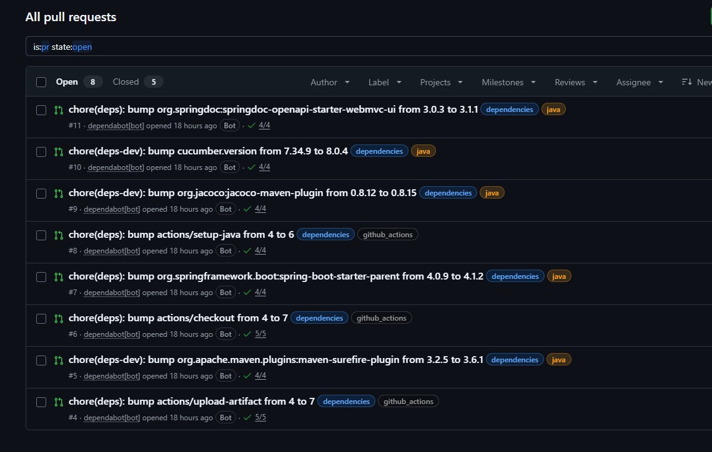

## Fase 4 — Despliegue automático y trazabilidad (IE4)

**Objetivo:** desplegar automáticamente en un entorno cloud simulado solo después de que pasen seguridad, pruebas y build, con trazabilidad completa hasta el commit. Detalle en el [`README.md`](../../README.md#despliegue-automático-ie4).

### 4.1 El deploy no corre en Pull Requests
En los PR se ejecutan seguridad, pruebas y build; el job `deploy` queda en *skipped* hasta el merge a `main`.

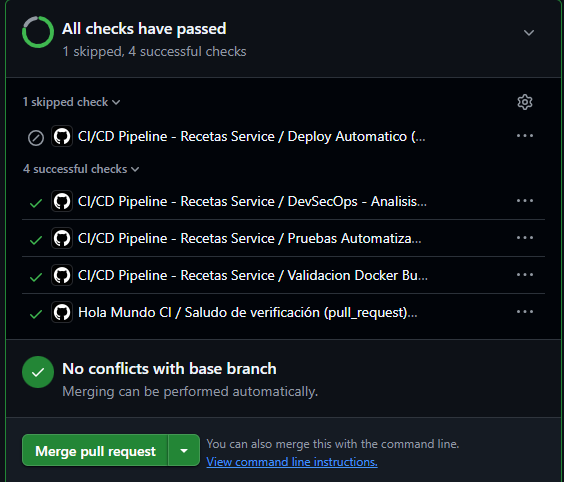

### 4.2 Pipeline completo en main
Tras el merge, los 4 jobs se ejecutan en secuencia: Seguridad → Pruebas → Build → Deploy.

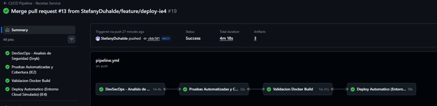

### 4.3 Verificación post-deploy
`/actuator/health` responde `UP`, `/api/recetas` responde 200 y ambas réplicas atienden peticiones.

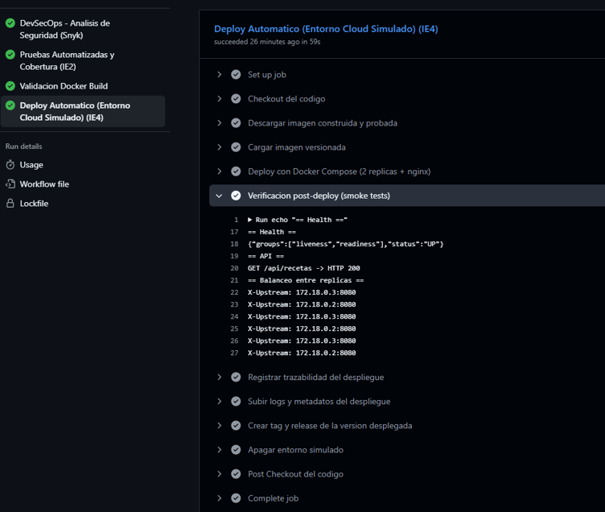

### 4.4 Trazabilidad: versión ligada al commit
El resumen del run muestra la versión, el SHA del commit y la imagen desplegada.

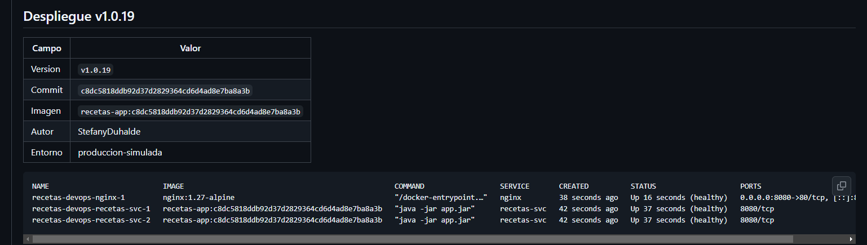

Cada despliegue genera un Release `v1.0.N` apuntando al commit desplegado.

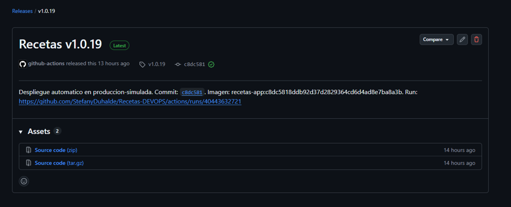

### 4.5 Logs y artefactos de auditoría

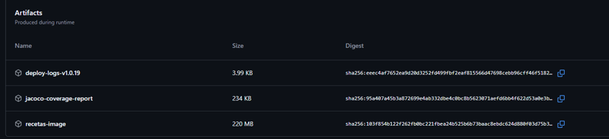

### 4.6 Historial de despliegues

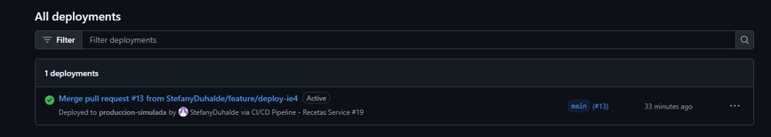

### 4.7 Prueba local del entorno (2 réplicas + nginx)

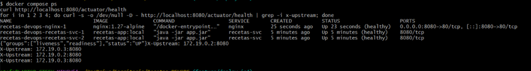